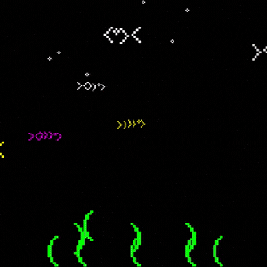

<p align="center">
  
</p>

# ASCII Aquarium

A little ASCII fish tank for the GeekMagic clock. Seaweed sways at the bottom, a few fish swim
around above it, and everything can be tweaked from the web panel while the screen keeps running.

## What's on screen

Everything is drawn with the same 5×7 pixel glyphs you'd see in a terminal, so the tank looks like
ASCII art instead of sprites. The background is black, the seaweed is green (you can pick another
colour), and nothing else is on the scene — no clock, no text.

## The seaweed

You can have up to 5 plants, each one at its own spot and 1–4 brackets tall. A bracket is one curved
arc, and a plant is a stack of them. Shape settings — height, overlap, curve, line thickness,
stagger — apply to all plants at once.

Then there's the sway: how far the plants lean, whether they lean as one or a wave runs up them, and
how slow the movement is. Set the amplitude to 0 and the tank goes completely still.

## The fish

Up to 6 fish. Each one gets a random species out of nine shapes: five made of round brackets — the
fry `><°>`, `><))°>`, `><)))°>`, the bent `><((°>` and the tailless `>)))°>` — and the same four
bodies again with curly braces, `><}}°>`, `><}}}°>`, `><{{°>` and `>}}}°>`.

Fish swim wherever they like: every few seconds one picks a new depth and drifts towards it, so they
cross paths and swim straight through each other. Switch **Swim** to *Lanes* in the Fish card and
every fish keeps to its own horizontal band again, the calmer look from before. Switching the mode
re-deals the fish, so each one starts fresh in the new layout.

Every fish rolls its size, colour, speed and bob when it swims in, and keeps them until it leaves.
The body bends as it goes and it bobs up and down in time with how fast it's moving. Now and then it
changes speed or turns around, and with animated turns switched on it squashes and flips instead of
snapping instantly.

## Bubbles

Fish let air bubbles go now and then. A bubble is a 3×3 ring of white pixels (`0x02, 0x05, 0x02`)
that drifts up slowly, swaying a little from side to side, and pops when it reaches the surface. The
settings sit in the **Bubbles** card of the Fish group: switch them off, the chance that a fish lets
one go after each roll (0–100 %), how often each fish rolls for one (0.3–10 s, 1.2 s by default) and
how fast a bubble rises (2–80 px/s).

## Eating

Fish can bite the seaweed. A few rules keep it looking sensible:

- only the tallest plant in the tank gets eaten, and only while it's whole — once it's bitten, the
  fish have to wait for it to grow back (they won't go for the shorter ones instead);
- only a fish cruising low over the plants bothers to dive, and its head has to be over the plant,
  not just any part of its body;
- it's a dice roll — the bite chance slider sets how often a fish actually stops.

A bite takes one bracket off, never the last one. The fish dips down to the tip, hovers for a moment
and swims on. The bracket grows back after the time you set, one level at a time.

Turn the whole thing off and the plants just stay at the length you gave them.

## The web panel

`/aquarium.html`, behind the usual login token. The settings are grouped into Seaweed, Seaweed shape,
Fish and Feeding, with the fish's bubbles in a card of their own inside the Fish group. Everything
applies to the screen as you drag, so you can tune it while watching the display. **Save** keeps the
settings after a reboot, **Refresh** reloads them from the device.

## Trying it without the device

[sim/aquarium.html](https://htmlpreview.github.io/?https://github.com/AlivE-git/GeekMagic-Open-Firmware-ASCII-Aquarium/blob/develop/sim/aquarium.html)  is a small browser simulator that runs the same maths as the firmware — the
same glyphs, the same seaweed arcs and sway, the same fish wave, the same bubbles and the same bite
rules. Open it locally and you get the very same settings laid out the same way, with the tank
redrawing live, so you can try a combination before flashing it to the clock.

## API

If you'd rather script it, `GET /api/v1/aquarium` returns the current settings and
`POST /api/v1/aquarium` changes any of them — partial updates are fine:

```bash
curl -X POST http://<device>/api/v1/aquarium \
  -H "Authorization: Bearer <token>" \
  -H "Content-Type: application/json" \
  -d '{"fish_swim": "lanes", "bubbles": true, "bubble_every_ms": 800, "persist": true}'
```

The fish settings worth knowing: `fish_swim` is `"free"` or `"lanes"`, `bubble_chance` goes 0–100 %,
`bubble_every_ms` 300–10000 and `bubble_rise` 2–80 px/s.

`persist: true` stores the change in flash; without it the settings live until the next reboot. Bad
values come back as a 400 with a message naming the field.

## A couple of things worth knowing

- What's already been bitten isn't saved to flash, so a reboot starts with full-length plants.
- Flashing the filesystem wipes `/aquarium.json`, and the tank goes back to its defaults.
- The web files are cached for a day; press Ctrl+F5 after updating the firmware.
